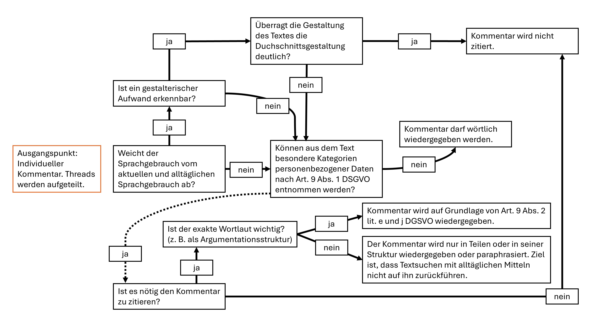

# README

# Wissen und Diskursmacht zwischen _Tagesschau_ und _YouTube_: Begleitmaterial
Begleitmaterial zum Forumsbeitrag 'Wissen und Diskursmacht zwischen Tagesschau und YouTube: Eine Frame-Semantische Untersuchung', erschienen in der 'Zeitschrift für Flucht- und Flüchtlingsforschung (Z'Flucht)' 10 Jg. 2/2026.

## Voraussetzungen

- Python 3.10.11
- Abhängigkeiten: siehe `requirements.txt`

## Pseudo-Code für die Erstellung des untersuchten Korpus 
### (tagesschau_pseudo-code_korpuserstellung.md)

Da der vorliegende Forumsbeitrag die Erstellung von Netwerkgraphen für die visuell unterstützte Analyse von Mediendiskurs fokussiert, werden die Python-Skripte für die Erstellung des Korpus nicht im Original reproduziert, sondern in einen sogenannten Pseudo-Code übersetzt. Dabei handelt es sich um eine Transliteration der verwendeten Skripte in eine 'natürliche' Sprache (überwiegend Deutsch). So ist die Reproduzierbarkeit gewährleistet, während durch die beiligenden Skripte die wesentlichen Schritte durchführbar sind.

Das gesamte Korpus ist in der tab-separierten Tabelle `tagesschau_korpus.csv` verzeichnet. Dort finden sich auch Links zu den VTT-Dateien. Dadurch wird diese Reproduktion des Korpus zusätzlich erleichtert.

## Visualisierung von frame-semantischen Annotationen 
### (tagesschau_visualisierungen.ipynb)

Das Jupyter Notebook `tagesschau_visualisierungen.ipynb` enthält den gesamten Python-Code für die Erstellung der Visualisierungen im Forumsbeitrag. Für die Reproduktion des Minimalbeipiels erwartet das Notebook die folgende Ordnerstruktur:

```
projektordner/
│
├── tagesschau_visualisierungen.ipynb
├── .python-version             ← Python 3.10.11 (pyenv)
├── requirements.txt            ← Abhängigkeiten
├── decision_tree_comments.jpg  (Abbildung im Jupyter Notebook)
├── tagesschau_korpus.csv       ← Verzeichnis aller (ca. 1000) Quellen des Korpus im gesamten Untersuchungszeitraum
│
├── annotated/                  ← XML-Annotationsdateien
│   ├── *_sub.xml               (Untertitel-Dateien)
│   └── *_com.xml               (Kommentar-Dateien)
│
├── dictionaries/               ← Zitationsverzeichnisse
│   └── Referenzen.txt          (Korpus-Referenzen als Python-Dict)
│
└── visualizations/             ← wird automatisch erstellt (mkdir)
    ├── Abbildung_3*.html       (Output)
    └── Abbildung_4*.html       (Output)
```
Es empfiehlt sich das, Notebook lokal mit dem Programm JupyterLab oder in einem Texteditor wie VSCode auszuführen. Für weitere Informationen zu Jupyter Notebooks und zum Programm JupyterLab siehe https://jupyter.org/.

## Hinweise zur Annotation der XML-Dateien

Bei der Annotation wurden die folgenden Tags verwendet:

````XML
## Annotationsschema für semantische Frames

### Anmerkung: Das Attribut 'frame' kann mehrere Werte haben, durch das Symbol '|' (pipe) getrennt.

# Frameevozierende Einheiten können auf verschiedenen Ebenen annotiert werden.
# So wird es möglich die Vernetzung der Frames darzustellen in dem auch Frameelemente von rekursiv auftretenden Frames (d. h. Frames in Slots des untersuchten Frames) annotiert werden können.
# Levels: 0 = untersuchter Frame, 1 = Filler / Teil des Fillers (bei Mehrworteinheiten oder Phrasen) des untersuchten Frames, 2 = Filler des Fillers, ...
# Die Annotationsebenen text und doc unterteilen die Dateien in eine grobe Textstruktur. Text ist das umfassende Tag für den gesammten Text einer Datei, während doc einzelne Texte (z. B. Kommentare innerhalb einer Kommentarspalte) unterteilt.
# Das inst-Tag umschließt Frame-Instantiierungen.

# Frameevozierende Einheiten
<element id="" type="fee" frame="Integration" level="0" parent="" slot="" relation="">
</element>

# Prädikatorenliste Konerding
<element type="fe" frame="" slot="Grund" id="" relation="" level="" parent="">
<element type="fe" frame="" slot="Ganzes" id="" relation="" level="" parent="">
<element type="fe" frame="" slot="Umstände" id="" relation="" level="" parent="">
<element type="fe" frame="" slot="Phasen" id="" relation="" level="" parent="">
<element type="fe" frame="" slot="Akteur" id="" relation="" level="" parent="">
<element type="fe" frame="" slot="Teil" id="" relation="" level="" parent="">
<element type="fe" frame="" slot="Kategorie" id="" relation="" level="" parent="">

# Aus dem erweiterten Inventar von Konerding
<element type="fe" frame="" slot="Maßnahmen" id="" relation="" level="" parent="">
<element type="fe" frame="" slot="Dauer" id="" relation="" level="" parent="">

# Selbst hinzugefügt
<element type="fe" frame="" slot="Folgen" relation="" level="" parent="">

<element type="fe" frame="" slot="" id="" relation="" level="" parent="">
<element type="fe" frame="" slot="" id="" relation="" level="" parent="">
<element type="fe" frame="" slot="" id="" relation="" level="" parent="">

<text id="" date="" section="">
</text>

<doc>
</doc>

<inst id="" frame="Integration">
</inst>
````
Dieses Tag-Set ist für dieses Minimalbeispiel ausreichend. Eine Überarbeitung nach den Standards der Text Encoding Initiative (TEI, https://tei-c.org/) ist für weitere Arbeiten vorgesehen.

### Minimalbeispiel für die Reproduzierbarkeit

Um die Ergebnisse der Beispieluntersuchung reproduzierbar zu machen, sind einzelne Texte der tagesschau-Untertitel und der YouTube-Kommentare nötig. Um dennoch den Schutz des Urheberrechts und des Personenrechts der Kommentierenden zu gewährleisten, wird jeglicher Text außerhalb der Instantiierungen der visualisierten Frames gelöscht. Außerdem werden Kommentare, nach vorheriger Prüfung, nicht als Werke nach dem Urheberrecht (§2 UrhG) gewertet (vgl. decision_tree_comments.jpg). Alle für das Minimalbeispiel verarbeiteten Werke werden auf die in den HTML-Visualisierungen zitierten Werkteile reduziert und die zitierten Werke in den Referenzen am Ende dieser Read-Me-Datei aufgeführt.

## Hinweise zum Datenschutz

Bei der Textsorte YouTube-Kommentar kann ein Spannungsverhältnis zwischen Urheberrecht und Datenschutz bestehen. Wenn ein Kommentar ein geschütztes Werk nach § 2 UrhG ist, gilt für dieses Werk das Zitatrecht nach § 51 UrhG. Ein wichtiges Kriterium für den Werkbegriff ist die Schöpfungshöhe. Dazu heißt es in einem Urteil des Landgerichts Bielefeld (2017):

„Damit das Schriftwerk urheberrechtlichen Schutz genießt, bedarf es grundsätzlich einer gewissen Schöpfungshöhe, die bei unterschiedlichen Werkarten unterschiedlich hoch angesetzt wird.“ (Dreyer in: Dreyer/Kotthoff/Meckel, Urheberrecht, 3. Aufl. 2013, § 2 Geschützte Werke, Rn. 59, zitiert in: Landgericht Bielefeld, 2017)

Da gewisse Teile der Kommentare aber aus Datenschutzgründen anonymisiert werden müssen, muss eine Entscheidung zu einem Zitat bei Kommentaren, die unter das Urheberrecht fallen können, gut abgewogen werden. Da es sich hier um Einzelfallentscheidungen handelt, sind die dafür festgelegten Entscheidungskriterien in Abbildung 1 skizziert. Diese Kriterien orientieren sich an der Entscheidung des Landesgerichts Bielefeld (2017) zur Schöpfungshöhe bei Tweets.
 


Die Datenschutzinformationen zu der hier durchgeführten Forschung werden öffentlich bereitgestellt, da ihre Erteilung an die von der Verarbeitung betroffenen Personen einen unverhältnismäßigen Aufwand erfordern würde. Dies würde die Verwirklichung der wissenschaftlichen Ziele der Verarbeitung unmöglich machen oder zumindest ernsthaft beeinträchtigen. Es sind mehrere hunderttausend Kommentare zu erwarten und eine direkte Kontaktmöglichkeit besteht auf YouTube nicht.

### Bereitstellung der Datenschutzinformationen

Zuerst veröffentlicht am 4. Dezember 2025 unter: [Master of Arts Linguistik im Kontext: Abschlussarbeiten](https://www.uni-potsdam.de/de/linguistik-im-kontext/aktuelles/abschlussarbeiten).

Wir verarbeiten bestimmte Kategorien Ihrer personenbezogenen Daten in anonymisierter Form und unter Beachtung der geltenden datenschutzrechtlichen Bestimmungen, insbesondere der EU-Datenschutz-Grundverordnung (DSGVO) und des Bundesdatenschutzgesetzes (BDSG).

#### Verantwortlicher für die Datenverarbeitung:

Peer Scholl  
c/o Universität Potsdam  
Master of Arts Linguistik im Kontext: Erwerb – Kommunikation – Mehrsprachigkeit  
Institut für Romanistik  
Am Neuen Palais 10  
14469 Potsdam

#### Zweck der Datenverarbeitung:

Ihre Daten werden zum Zweck der Durchführung einer Studie für eine Masterarbeit und damit verbundene wissenschaftliche Veröffentlichungen verarbeitet.

Eines der Ziele der Forschung ist, besser zu verstehen, wie Wissen zu den Themen Migration und Bildung in Kommentaren auf der Videostreamingplattform YouTube rezipiert und (re-)produziert wird. Dafür ist es notwendig, das in den Kommentaren (re-)produzierte Wissen auf das in Nachrichtenbeiträgen der tagesschau (re-)produzierte Wissen zu beziehen. Der Untersuchungsgegenstand der Studie sind semantische Frames, weshalb die Texte der Kommentare erfasst und teilweise qualitativ untersucht werden. Des Weiteren ist es nötig, jeweils die ID, den Veröffentlichungszeitpunkt und den Nutzernamen in anonymisierter Form für die interne Datenverarbeitung zu erfassen, um die Interaktion nachvollziehen zu können.

#### Rechtsgrundlage der Datenverarbeitung
Die Rechtsgrundlage für die Datenverarbeitung ergibt sich aus Art. 6 Abs. 1 S. 1 lit. f DSGVO (Wahrnehmung berechtigter Interessen). Die Vorschrift erlaubt u. a. zu wissenschaftlichen Forschungszwecken Verarbeitungen auch ohne Einwilligungen der betroffenen Person, wenn schutzwürdige Belange der betroffenen Person wegen der Offenkundigkeit der Daten nicht entgegenstehen. Soweit sich die Verarbeitung auf besondere Kategorien personenbezogener Daten im Sinne von Art. 9 Abs. 1 DSGVO bezieht, ergibt sich die Rechtsgrundlage aus Art. 9 Abs. 2 lit. j DSGVO in Verbindung mit § 27 BDSG. Danach können besondere Kategorien personenbezogener Daten auch ohne Einwilligung für wissenschaftliche Forschungszwecke verarbeitet werden, wenn die Interessen des Verantwortlichen an der Verarbeitung die Interessen der betroffenen Person an einem Ausschluss der Verarbeitung erheblich überwiegen. Das ist in Bezug auf das oben beschriebene Forschungsvorhaben der Fall, denn bei den verarbeiteten Daten handelt es sich um Kommentare auf der Plattform YouTube, die von den betroffenen Personen selbst öffentlich gemacht wurden (vgl. auch Art. 9 Abs. 2 lit. e DSGVO, der insoweit ebenfalls als Rechtsgrundlage herangezogen werden kann).

#### Art der Daten
Bei der Datenverarbeitung werden folgende Kategorien von Daten, jeweils bezogen auf einen Kommentar, erhoben:
-	YouTube-Nutzername der/des Autorin/en für die Pseudonymisierung (nur temporär gespeichert)
Nutzernamen werden bei der Datenerhebung umgehend anonymisiert. Anschließend können die Pseudonyme nicht mehr auf die Ausgangsform zurückgeführt werden.
-	Likes und Antwort(en), falls vorhanden
-	Interne ID des Kommentars
-	Zeitpunkt der Veröffentlichung
-	Ggf. besondere Kategorien personenbezogener Daten nach Art. 9 Abs. 1 DSGVO:  Bei einer Korpusuntersuchung von YouTube-Kommentaren ist nicht abzusehen, welche besonderen Kategorien personenbezogener Daten im gesamten Korpus vorkommen.
- Im Rahmen des geplanten Forschungsvorhabens sind die folgenden Kategorien zu erwarten:
  - politische Meinungen
  - religiöse oder weltanschauliche Überzeugungen

#### Herkunft der Daten
Die Daten werden von YouTube über die YouTube Data API v3 bezogen. Abgefragt werden Kommentare zu Sendungen der 20-Uhr-Ausgabe der tagesschau, im Zeitraum vom 20. Januar 2022 bis 25. Februar 2025. Alle verarbeiteten Kommentare wurden zu Videos der Playlist ‚tagesschau 20 Uhr‘ auf dem YouTube-Kanal @tagesschau veröffentlicht.

#### Dauer der Datenspeicherung
Die Daten werden mit einem Skript in der Programmiersprache Python erhoben. Damit Nutzernamen auch in Texten identifiziert und anonymisiert werden können, ist es nötig, eine temporäre Liste der Nutzernamen zu führen. Diese Liste wird für die Dauer der Textverarbeitung lokal auf dem privaten PC des Projektverantwortlichen gespeichert. Die Verarbeitung nimmt wenige Stunden in Anspruch (über Nacht), wonach die Nutzernamenliste umgehend und endgültig gelöscht wird.

#### Empfänger der Daten
Da das Ziel des Projekts die Erstellung einer Masterarbeit ist, die im Rahmen der Denkwerkstatt ‚Schulische Sprachwelten‘ entsteht, kann es im Projektverlauf notwendig, werden personenbezogene Daten nach Art. 9 DSGVO der oben beschriebenen Art an betreuende Personen weiterzugeben. Eine Notwendigkeit kann zum Beispiel im Rahmen von wissenschaftlicher Beratung oder der Benotung der Masterarbeit entstehen.

Des Weiteren werden Daten (Texte aus dem Korpus, nach Anonymisierung der Nutzernamen) für die Einreichung eines Beitrags in dem Themenheft ‚Flucht, Migration und Bildung im digitalen Wandel‘ der Zeitschrift für Flucht- und Flüchtlingsforschung (Nomos), für die Begutachtung über ein passwortgeschütztes Repositorium bereitgestellt. Diese können personenbezogene Daten nach Art. 9 DSGVO der oben beschriebenen Arten enthalten und werden nach vollendeter Begutachtung wieder gelöscht. Da es sich um ein anonymes Begutachtungsverfahren handelt, können hier keine Personen benannt werden.

#### Ihre Rechte:
Sie haben das Recht, von mir Auskunft über die Verarbeitung Sie betreffender, personenbezogener Daten zu verlangen. Dieses Auskunftsrecht umfasst neben einer Kopie der personenbezogenen Daten auch die Zwecke der Datenverarbeitung, Datenempfänger sowie die Speicherdauer.

Sollten unrichtige personenbezogene Daten verarbeitet werden, können Sie von uns die Berichtigung dieser Daten verlangen. Liegen die gesetzlichen Voraussetzungen aus Art. 17 bzw. 18 DSGVO vor, steht Ihnen zudem grundsätzlich das Recht auf Löschung personenbezogener Daten oder auf eine Einschränkung der Verarbeitung zu. Bitte beachten Sie, dass eine eingeschränkte Verarbeitung der Daten unter Umständen nicht möglich ist. Sie haben das Recht, Ihre personenbezogenen Daten in einem strukturierten, gängigen und maschinenlesebaren Format zu erhalten oder die Übermittlung an einen anderen Verantwortlichen zu verlangen (Art. 20 DSGVO). Des Weiteren können Sie unter den Voraussetzungen von Art. 21 DSGVO der Verarbeitung widersprechen.

Falls Sie der Ansicht sind, dass die Verarbeitung Ihrer personenbezogenen Daten nicht rechtmäßig erfolgt, haben Sie das Recht, bei der zuständigen Aufsichtsbehörde für Datenschutz eine Beschwerde einzureichen.

## Referenzen

### Literatur:

Dreyer, G., Kotthoff, J., & Meckel, A. (2013). Urheberrecht : Urheberrechtsgesetz, Urheberrechtswahrnehmungsgesetz, Kunsturhebergesetz / von Gunda Dreyer ; Jost Kotthoff ; Astrid Meckel. Unter Mitarb. von Hans-Joachim Zeisberg. (3., neu bearb. Aufl.). Müller.
Landgericht Bielefeld. (2017). ECLI:DE:LGBI:2017:0103.4O144.16.00. https://nrwe.justiz.nrw.de/lgs/bielefeld/lg_bielefeld/j2017/4_O_144_16_Beschluss_20170103.html

Neumair, P. A. (2022). Die Bedeutung von Flüchtling, Geflüchtete_r und Migrant_in: Eine frame-semantische Untersuchung zum Diskurs zur sog. Flüchtlingskrise. Theorie und Praxis der Diskursforschung. Springer Nature. https://doi.org/10.1007/978-3-658-36719-0

### Korpusbelege:

Daubner, S. (25. April 2022a). tagesschau, 20:00 Uhr. ARD. https://www.ardmediathek.de/video/tagesschau/tagesschau-20-00-uhr/das-erste/Y3JpZDovL2Rhc2Vyc3RlLmRlL3RhZ2Vzc2NoYXUvYTIyZWM4ODgtMDVlZS00NjcxLWE5OGQtMDkzZDk4ODY4NTNlLzE

Daubner, S. (2. Dezember 2022b). tagesschau, 20:00 Uhr. ARD. https://www.ardmediathek.de/video/tagesschau/tagesschau-20-00-uhr/das-erste/Y3JpZDovL2Rhc2Vyc3RlLmRlL3RhZ2Vzc2NoYXUvN2VlYWE0MmItYzdmMS00YmEwLWEyNWItNWY3NjQ2M2U3M2Q5LzE

Daubner, S. (16. Februar 2023a). tagesschau, 20:00 Uhr. ARD. https://www.ardmediathek.de/video/tagesschau/tagesschau-20-00-uhr/das-erste/Y3JpZDovL2Rhc2Vyc3RlLmRlL3RhZ2Vzc2NoYXUvMzc3MzhjZTctNjJjOS00MjNhLWE4MjktNjk0OTZiYmEyYTFhLzE

Daubner, S. (19. Februar 2023b). tagesschau, 20:00 Uhr. ARD. https://www.ardmediathek.de/video/tagesschau/tagesschau-20-00-uhr/das-erste/Y3JpZDovL2Rhc2Vyc3RlLmRlL3RhZ2Vzc2NoYXUvNmNiNTJiOWYtYjZmMy00Mjc1LWI2NzAtNmY0ODA3MTllNTFlLzE

Daubner, S. (24. Oktober 2024a). tagesschau 20:00 Uhr, 24.10.2024. ARD. https://www.ardmediathek.de/video/tagesschau/tagesschau-20-00-uhr/das-erste/Y3JpZDovL3RhZ2Vzc2NoYXUuZGUvMThlZDc1MDYtZmM2YS00NDEzLWI2MzctNjk4MGY2NzE2NjA5LVNFTkRVTkdTVklERU8

Daubner, S. (24. Oktober 2024b). tagesschau 20:00 Uhr, 24.10.2024. ARD. https://www.ardmediathek.de/video/tagesschau/tagesschau-20-00-uhr/das-erste/Y3JpZDovL3RhZ2Vzc2NoYXUuZGUvMThlZDc1MDYtZmM2YS00NDEzLWI2MzctNjk4MGY2NzE2NjA5LVNFTkRVTkdTVklERU8

Riewa, J. (20. Juli 2024). tagesschau 20:00 Uhr, 20.07.2024. ARD. https://www.ardmediathek.de/video/tagesschau/tagesschau-20-00-uhr/das-erste/Y3JpZDovL3RhZ2Vzc2NoYXUuZGUvMGNmZmU3ZWEtYzEzMC00NWM4LWI1NTUtMWJiZGQxYTM1NGQ0LVNFTkRVTkdTVklERU8

Schreiber, C. (4. Juli 2024). tagesschau 20:00 Uhr, 04.07.2024. ARD. https://www.ardmediathek.de/video/tagesschau/tagesschau-20-00-uhr/das-erste/Y3JpZDovL3RhZ2Vzc2NoYXUuZGUvYmUyODBlNGItZDczNy00MTEyLTk2ZDUtMGQyYzNmNzRhMTg0LVNFTkRVTkdTVklERU8

Schröder, T. (29. Februar 2024). tagesschau 20:00 Uhr, 29.02.2024. ARD. https://www.ardmediathek.de/video/tagesschau/tagesschau-20-00-uhr/das-erste/Y3JpZDovL3RhZ2Vzc2NoYXUuZGUvZjAzMWYwMjItMTk1MS00MDY3LWFmNWItOWVmOTQ4MzI4NzBjLVNFTkRVTkdTVklERU8

Sen, J.‑N. (14. Juni 2022). tagesschau, 20:00 Uhr. ARD. https://www.ardmediathek.de/video/tagesschau/tagesschau-20-00-uhr/das-erste/Y3JpZDovL2Rhc2Vyc3RlLmRlL3RhZ2Vzc2NoYXUvNzJjNmQ4MTItNGQ3OS00OWMzLTlmMjQtNWU0YWY3YjNmYWNlLzE

### Frames im Framenet des Deutschen:

Gehrecke, F. (o. Da). Absichtlich_handeln. Zugriff am 5. Dezember 2025, verfügbar unter https://framenet-constructicon.hhu.de/framenet/frame?id=479

Gehrecke, F. (o. Db). Behandeln_und_Misshandeln. Zugriff am 6. Dezember 2025, verfügbar unter https://framenet-constructicon.hhu.de/framenet/frame?id=836

Gehrecke, F. (o. Dc). Behindern. Zugriff am 5. Dezember 2025, verfügbar unter https://framenet-constructicon.hhu.de/framenet/frame?id=1073

Gehrecke, F. (o. Dd). Bereitschaft. Zugriff am 7. Februar 2026, verfügbar unter https://framenet-constructicon.hhu.de/framenet/frame?id=307

Gehrecke, F. (o. De). Bewerten. Zugriff am 5. Dezember 2025, verfügbar unter https://framenet-constructicon.hhu.de/framenet/frame?id=1096

Gehrecke, F. (o. Df). Geld. Zugriff am 5. Dezember 2025, verfügbar unter https://framenet-constructicon.hhu.de/framenet/frame?id=366

Gehrecke, F. (o. Dg). Gesamtheit. Zugriff am 6. Dezember 2025, verfügbar unter https://framenet-constructicon.hhu.de/framenet/frame?id=18

Gehrecke, F. (o. Dh). Kommunikation. Zugriff am 5. Dezember 2025, verfügbar unter https://framenet-constructicon.hhu.de/framenet/frame?id=1115

Gehrecke, F. (o. Di). Menschen. Zugriff am 5. Dezember 2025, verfügbar unter https://framenet-constructicon.hhu.de/framenet/frame?id=933

Gehrecke, F. (o. Dj). Personen_nach_Alter. Zugriff am 9. Oktober 2025, verfügbar unter https://framenet-constructicon.hhu.de/framenet/frame?id=1213

Gehrecke, F. (o. Dk). Personen_nach_Moral. Zugriff am 6. Dezember 2025, verfügbar unter https://framenet-constructicon.hhu.de/framenet/frame?id=46

Gehrecke, F. (o. Dl). Politische_Örtlichkeit. Zugriff am 5. Dezember 2025, verfügbar unter https://framenet-constructicon.hhu.de/framenet/frame?id=472

Gehrecke, F. (o. Dm). Unterkunft_Szenario. Zugriff am 5. Dezember 2025, verfügbar unter https://framenet-constructicon.hhu.de/framenet/frame?id=446

Gehrecke, F. (o. Dn). Verbesserung_oder_Verschlechterung. Zugriff am 5. Dezember 2025, verfügbar unter https://framenet-constructicon.hhu.de/framenet/frame?id=926

Gehrecke, F. (o. Do). Voraussetzung_Szenario. Zugriff am 5. Oktober 2025, verfügbar unter https://framenet-constructicon.hhu.de/framenet/frame?id=211

Heinrich-Heine-Universität Düsseldorf. (o. Da). Arbeit. Zugriff am 5. Dezember 2025, verfügbar unter https://framenet-constructicon.hhu.de/framenet/frame?id=425

Heinrich-Heine-Universität Düsseldorf. (o. Db). Ausland_oder_Inland. Zugriff am 5. Dezember 2025, verfügbar unter https://framenet-constructicon.hhu.de/framenet/frame?id=208

Heinrich-Heine-Universität Düsseldorf. (o. Dc). Diversität. Zugriff am 5. Dezember 2025, verfügbar unter https://framenet-constructicon.hhu.de/framenet/frame?id=426

Heinrich-Heine-Universität Düsseldorf. (o. Dd). Dokumente. Zugriff am 5. Dezember 2025, verfügbar unter https://framenet-constructicon.hhu.de/framenet/frame?id=1109

Heinrich-Heine-Universität Düsseldorf. (o. De). Eigenbewegung. Zugriff am 5. Dezember 2025, verfügbar unter https://framenet-constructicon.hhu.de/framenet/frame?id=1124

Heinrich-Heine-Universität Düsseldorf. (o. Df). Emotionen_durch_Stimulus. Zugriff am 5. Dezember 2025, verfügbar unter https://framenet-constructicon.hhu.de/framenet/frame?id=513

Heinrich-Heine-Universität Düsseldorf. (o. Dg). Ereignisdauer_ändern. Zugriff am 5. Dezember 2025, verfügbar unter https://framenet-constructicon.hhu.de/framenet/frame?id=372

Heinrich-Heine-Universität Düsseldorf. (o. Dh). Erfolg_oder_Fehlschlag. Zugriff am 6. Dezember 2025, verfügbar unter https://framenet-constructicon.hhu.de/framenet/frame?id=178

Heinrich-Heine-Universität Düsseldorf. (o. Di). Gewissheit. Zugriff am 5. Dezember 2025, verfügbar unter https://framenet-constructicon.hhu.de/framenet/frame?id=185

Heinrich-Heine-Universität Düsseldorf. (o. Dj). Grenze. Zugriff am 5. Dezember 2025, verfügbar unter https://framenet-constructicon.hhu.de/framenet/frame?id=958

Heinrich-Heine-Universität Düsseldorf. (o. Dk). Handel_Szenario. Zugriff am 5. Dezember 2025, verfügbar unter https://framenet-constructicon.hhu.de/framenet/frame?id=1174

Heinrich-Heine-Universität Düsseldorf. (o. Dl). Knappheit. Zugriff am 5. Dezember 2025, verfügbar unter https://framenet-constructicon.hhu.de/framenet/frame?id=284

Heinrich-Heine-Universität Düsseldorf. (o. Dm). Suchen. Zugriff am 5. Dezember 2025, verfügbar unter https://framenet-constructicon.hhu.de/framenet/frame?id=799

Heinrich-Heine-Universität Düsseldorf. (o. Dn). Versorgung. Zugriff am 5. Dezember 2025, verfügbar unter https://framenet-constructicon.hhu.de/framenet/frame?id=156

Neumair, P. A. (o. Da). Ähnlichkeit. Zugriff am 9. Oktober 2025, verfügbar unter https://framenet-constructicon.hhu.de/framenet/frame?id=1074

Neumair, P. A. (o. Db). Beschreibung_Dauer. Zugriff am 5. Dezember 2025, verfügbar unter https://framenet-constructicon.hhu.de/framenet/frame?id=1160

Neumair, P. A. (o. Dc). Bewertender_Vergleich. Zugriff am 5. Dezember 2025, verfügbar unter https://framenet-constructicon.hhu.de/framenet/frame?id=985

Neumair, P. A. (o. Dd). Bildung_Lehre. Zugriff am 30. September 2025, verfügbar unter https://framenet-constructicon.hhu.de/framenet/frame?id=48

Neumair, P. A. (o. De). Erfolgreiche_Vollendung. Zugriff am 5. Dezember 2025, verfügbar unter https://framenet-constructicon.hhu.de/framenet/frame?id=227

Neumair, P. A. (o. Df). Erwerbstätigkeit. Zugriff am 5. Dezember 2025, verfügbar unter https://framenet-constructicon.hhu.de/framenet/frame?id=849

Neumair, P. A. (o. Dg). Fähigkeit. Zugriff am 5. Dezember 2025, verfügbar unter https://framenet-constructicon.hhu.de/framenet/frame?id=1221

Neumair, P. A. (o. Dh). Grad_des_Kraftwiderstandes. Zugriff am 7. Oktober 2025, verfügbar unter https://framenet-constructicon.hhu.de/framenet/frame?id=528

Neumair, P. A. (o. Di). Inkrement. Zugriff am 5. Dezember 2025, verfügbar unter https://framenet-constructicon.hhu.de/framenet/frame?id=3

Neumair, P. A. (o. Dj). Institutionen. Zugriff am 8. Oktober 2025, verfügbar unter https://framenet-constructicon.hhu.de/framenet/frame?id=285

Neumair, P. A. (o. Dk). Kompetenz. Zugriff am 7. Februar 2026, verfügbar unter https://framenet-constructicon.hhu.de/framenet/frame?id=163

Neumair, P. A. (o. Dl). Militär. Zugriff am 7. Februar 2026, verfügbar unter https://framenet-constructicon.hhu.de/framenet/frame?id=224

Neumair, P. A. (o. Dm). Personen_nach_Gerichtsbarkeit. Zugriff am 7. Februar 2026, verfügbar unter https://framenet-constructicon.hhu.de/framenet/frame?id=1214

Neumair, P. A. (o. Dn). Personen_nach_Herkunft. Zugriff am 9. Oktober 2025, verfügbar unter https://framenet-constructicon.hhu.de/framenet/frame?id=1214

Neumair, P. A. (o. Do). Schwierigkeit. Zugriff am 5. Oktober 2025, verfügbar unter https://framenet-constructicon.hhu.de/framenet/frame?id=1007

Neumair, P. A. (o. Dp). Unterstützen. Zugriff am 5. Oktober 2025, verfügbar unter https://framenet-constructicon.hhu.de/framenet/frame?id=483

Triesch, S. (o. D). Verpflichtung_Szenario. Zugriff am 6. Dezember 2025, verfügbar unter https://framenet-constructicon.hhu.de/framenet/frame?id=212


